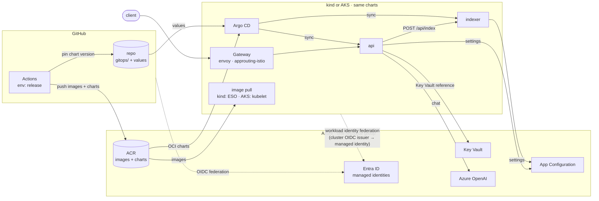

# aks-lab

A throwaway lab. It tests one idea: a Python platform built for Azure managed services can run its workloads on
Kubernetes, with Azure kept as the control plane.

The platform has two workloads. On Azure, the api (FastAPI) runs on App Service and the indexer (Azure Functions)
runs on a Function App. Here both run as Kubernetes Deployments, on a local kind cluster (on-prem stand-in) and on
AKS, from the same images and charts. Only compute moves. Identity, configuration, secrets, artifacts and AI stay on
Azure, and the pods reach them over HTTPS.

This is a prototype. Every decision is provisional.

## Architecture

Argo CD pulls the charts from ACR and the values from git, then deploys the workloads. The client reaches the api
through the gateway, and the api calls the indexer inside the cluster. The pods sign in to Entra with their
service-account token, because Entra trusts each cluster's OIDC issuer. With that token they read settings, secrets
and AI from Azure.

## Key decisions

### Azure-first apps run unchanged

The apps use the Azure SDK as they would on App Service or a Function App: `DefaultAzureCredential` for identity and
the App Configuration provider for settings. The same code and images run on kind and AKS. Only the Helm values
differ per cluster. The Functions host image runs as a plain Deployment with HTTP triggers and no storage account.

### Workload identity federation on both clusters

No pod holds an Azure secret. Each cluster has an OIDC issuer, and Entra trusts it through federated credentials. A pod
exchanges its Kubernetes service-account token for an Entra token.

| | kind | AKS |
|---|---|---|
| OIDC issuer | Self-published: the lab key pair signs tokens, and the discovery documents sit in public blob storage | AKS managed issuer |
| Token in the pod | Projected service-account token and `AZURE_*` variables, set by the chart | AKS workload identity webhook |
| Image pull (kubelet) | External Secrets Operator generates a short-lived ACR token with its own federated identity | Kubelet identity with `AcrPull` |
| Chart pull (Argo CD) | Repo server with workload identity | Same |

The kubelet cannot use workload identity, so image pull needs a separate path on each cluster. External Secrets
Operator runs on kind only for this reason.

CI follows the same idea: GitHub Actions signs in to Azure with OIDC federation, so the repository stores no cloud
secret.

### One managed identity per workload, least privilege

Each workload identity carries one federated credential per cluster, so the same identity works on kind and AKS.

| Identity | Roles |
|---|---|
| `api` | App Configuration Data Reader, Key Vault Secrets User, Cognitive Services OpenAI User |
| `indexer` | App Configuration Data Reader |
| `argocd` | `AcrPull` |
| `eso` (kind only) | `AcrPull` |
| `github` | `AcrPush` |

Local auth is off where Azure allows it. App Configuration runs in pass-through mode. AKS has no local accounts and
uses Entra with Azure RBAC.

### Artifacts on ACR, delivery through GitOps

- CI builds each image and Helm chart once, at the tag version, and pushes both to ACR as OCI artifacts.
- Argo CD pulls the chart from ACR and the values from git (multi-source app). One app-of-apps root per cluster.
- The release job pins the new chart version for every cluster in one git commit. The image tag follows the chart
  `appVersion`. Git records what runs; rollback is a revert.
- CI never reaches into a cluster.

### App Configuration as the config plane

- One store serves every environment. A label selects the cluster (`local`, `aks-dev`).
- The SDK resolves Key Vault references, so no secrets operator is needed for app secrets.
- A sentinel key triggers a refresh. Values change live, with no restart.
- Azure OpenAI is an external dependency. Its endpoint and deployment name live in App Configuration, so a provider
  change is a config change.

### Bicep for Azure, GitOps for the cluster

- `infra/main.bicep` holds the shared control plane: ACR, App Configuration, Key Vault, Azure OpenAI, identities
  and the budget.
- Each cluster is a plugin in `infra/clusters/`, deployed as its own deployment stack. Deleting the stack removes
  what that cluster added: its federated credentials, roles, key values and, for AKS, the cluster itself.
- Every deploy runs a what-if first. Everything inside a cluster goes through Argo CD.

### Same routes on both clusters

Gateway API with Envoy Gateway on both clusters. One chart holds the Gateway and routes. On AKS, the gateway binds a
static public IP with a DNS label, and cert-manager issues a Let's Encrypt certificate.

## Not covered

High availability, backups, hardening, autoscaling, data stores, queues, Functions trigger backends, observability,
in-cluster AI inference, air-gapped mirroring and user sign-in.
